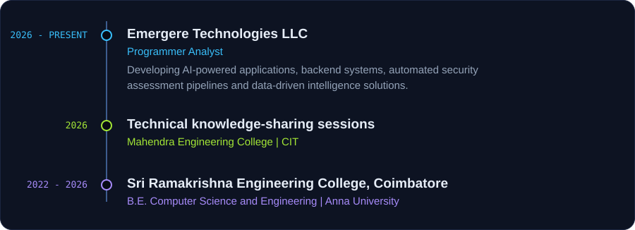
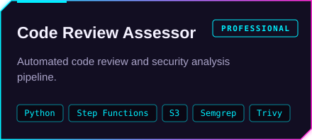
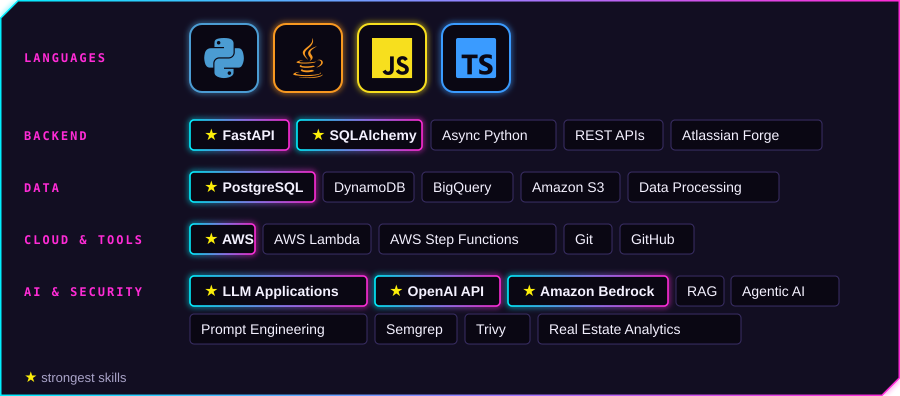
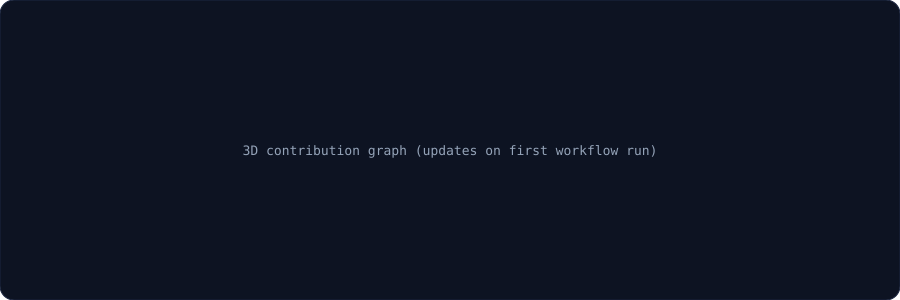
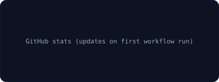
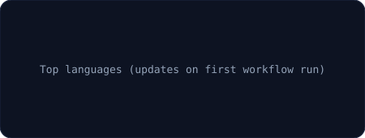

I'm a Programmer Analyst focused on building intelligent applications, scalable backend systems and AI-powered solutions. I currently work on LLM-based applications, automated security assessment, cloud-native architectures and real-estate intelligence systems. I'm passionate about Agentic AI, backend architecture and solving real-world engineering problems.

  
  
  
  
  

Professional projects are shown by name only. Source code is private.

<picture>
  <source media="(prefers-color-scheme: dark)" srcset="./profile/snake-dark.svg" />
  <source media="(prefers-color-scheme: light)" srcset="./profile/snake.svg" />
  
</picture>

  
  

  
  
  

