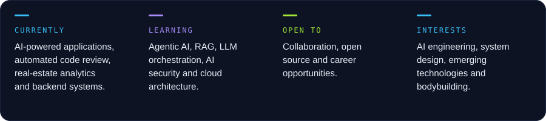
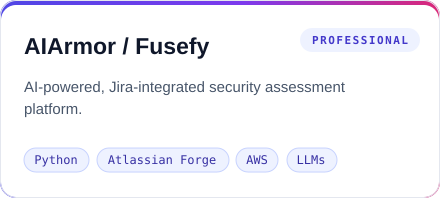
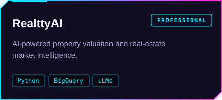
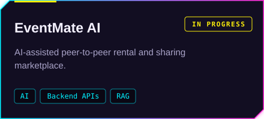
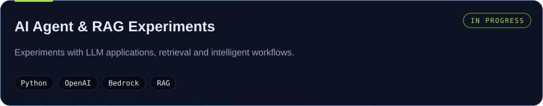

<picture><source media="(prefers-color-scheme: dark)" srcset="./assets/hero-v2.svg"></picture>

<picture><source media="(prefers-color-scheme: dark)" srcset="./assets/h-about.svg"></picture>

I'm a Programmer Analyst focused on building intelligent applications, scalable backend systems and AI-powered solutions. I currently work on LLM-based applications, automated security assessment, cloud-native architectures and real-estate intelligence systems. I'm passionate about Agentic AI, backend architecture and solving real-world engineering problems.

<picture><source media="(prefers-color-scheme: dark)" srcset="./assets/about.svg"></picture>

<picture><source media="(prefers-color-scheme: dark)" srcset="./assets/h-experience.svg"></picture>

<picture><source media="(prefers-color-scheme: dark)" srcset="./assets/experience.svg"></picture>

<picture><source media="(prefers-color-scheme: dark)" srcset="./assets/h-projects.svg"></picture>

  <picture><source media="(prefers-color-scheme: dark)" srcset="./assets/card-aiarmor.svg"></picture>
  <picture><source media="(prefers-color-scheme: dark)" srcset="./assets/card-review.svg"></picture>
  <picture><source media="(prefers-color-scheme: dark)" srcset="./assets/card-realttyai.svg"></picture>
  <picture><source media="(prefers-color-scheme: dark)" srcset="./assets/card-eventmate.svg"></picture>
  <picture><source media="(prefers-color-scheme: dark)" srcset="./assets/card-agents.svg"></picture>

Professional projects are shown by name only. Source code is private.

<picture><source media="(prefers-color-scheme: dark)" srcset="./assets/h-skills.svg"></picture>

<picture><source media="(prefers-color-scheme: dark)" srcset="./assets/skills.svg"></picture>

<picture><source media="(prefers-color-scheme: dark)" srcset="./assets/h-contact.svg"></picture>

  <a href="https://www.linkedin.com/in/vivekanandan-t/" title="Open my LinkedIn profile"><picture><source media="(prefers-color-scheme: dark)" srcset="./assets/btn-linkedin.svg"></picture></a>
  <a href="mailto:vivekthambi17@gmail.com" title="Send me an email"><picture><source media="(prefers-color-scheme: dark)" srcset="./assets/btn-email.svg"></picture></a>
  <a href="https://github.com/VivekanandanT" title="My GitHub profile"><picture><source media="(prefers-color-scheme: dark)" srcset="./assets/btn-github.svg"></picture></a>

<picture><source media="(prefers-color-scheme: dark)" srcset="./assets/footer.svg"></picture>
